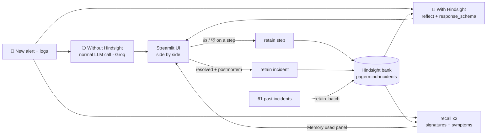

# 🧠 PagerMind: an on-call assistant that remembers every outage

**PagerMind helps the engineer on duty fix production problems faster by remembering every past incident**: what broke, what was tried, what *didn't* work, and what finally fixed it. It is built on **[Hindsight](https://hindsight.vectorize.io/)** memory, and it gets smarter with every incident it helps resolve.

> Built for the *"AI Agents That Learn Using Hindsight"* hackathon.

---

## The problem

At 3 AM the payment page stops working. The engineer on call has never seen this error. They search old chat threads, wake up a senior colleague, and spend 40+ minutes on a problem **the team already solved three times before**. Restarting the servers doesn't help, and never has.

Team knowledge lives in people's heads and in postmortems nobody reads. When the senior engineer who knew the fix leaves the company, the knowledge leaves too.

## The idea

Give the on-call team a **shared long-term memory**. For every alert, PagerMind shows **two answers side by side**:

| ⚪ Without Hindsight | 🧠 With Hindsight |
|---|---|
| A normal LLM API call (Groq): just the alert and its logs | The same alert and logs, answered by **Hindsight `reflect`** over the team's memory of every past incident |
| Gives generic advice from the logs alone | Knows what happened before: which incidents match, what failed, what fixed it |

And it **learns**: every 👍/👎 on a suggested step and every resolved incident is saved back to Hindsight, so the next alert gets a better answer.

---

## How PagerMind uses Hindsight

Memory is not a side feature. **Without Hindsight, PagerMind is a generic chatbot.** Both answers get exactly the same input (the alert and its logs), so the only difference is Hindsight's memory. All Hindsight code is in [`pagermind/memory.py`](pagermind/memory.py).



| When | Hindsight API | What we do |
|---|---|---|
| **Setup** | `create_bank(mission, retain_mission, observations_mission, reflect_mission, disposition)` | One bank is the whole on-call team's memory. The missions tell Hindsight to extract *error signatures, what worked, what did NOT work*. |
| **Load history** | `retain_batch(items)` | 61 past incidents, one document each (`document_id=INC-xxxx`), with real timestamps, `tags=["service:…","severity:…"]` and metadata. |
| **Alert fires** | `reflect(query, context, response_schema=CARD_SCHEMA, include_facts=True)` | Hindsight reasons over the whole bank and returns the **suggestion card as JSON**: matched incidents, likely cause, what to avoid (with evidence), steps with commands, `is_strong_match`. The live logs go in as `context`. |
| **Memory used panel** | `recall()` ×2, in parallel with reflect | reflect's `based_on` facts don't carry their incident id, so a fast recall runs at the same time to show *which* incidents were used. Search 1 uses only the **error signatures** from the logs (weight 2), search 2 the **symptoms** (weight 1), fused by reciprocal rank. |
| **Engineer feedback** | `retain(update_mode="append")` | 👍 / 👎 on any suggested step is stored, **including failures**. |
| **Incident resolved** | `retain(document_id=new id)` | The postmortem becomes a new memory, so the next similar alert recalls it. |

### Guardrails on top of reflect

- Only incident IDs that really exist in the bank can be cited.
- No "seen before" unless reflect says `is_strong_match: true`. For a brand-new problem the card honestly says *"this looks new"*.
- Never "avoid" an action the same card recommends (e.g. when a restart *did* fix this problem before).

### Why two searches for the memory panel?

Two payments incidents can have the *same symptoms* ("payments-api p99 > 3s, 5xx errors at 2 AM") and **completely different causes**: a database connection pool running out versus the payment gateway timing out. A single query built from the alert title mixed them up. Searching on **error signatures first** (`HikariPool-1 - Connection is not available` vs `razorpay read timeout after 10000ms`) separates them. We also drop healthy log lines (e.g. `Pool stats … waiting=0`), because they are evidence *against* a pool problem but would still pull pool incidents into the results.

```python
# pagermind/memory.py (simplified)
searches = [(signature_query(log_lines), 2.0),                       # error signatures
            (f"{alert['title']} on {alert['service']}", 1.0)]        # symptoms
for query, weight in searches:
    for rank, match in enumerate(group_by_incident(self.recall(query)), 1):
        scores[match.incident_id] += weight / (10 + rank)            # reciprocal-rank fusion
```

---

## Without vs with Hindsight (real output)

Both answers get exactly the same alert and log lines. The only difference is Hindsight's memory.

**Alert:** `payments-api p99 latency > 3s and 5xx rate > 5%` with `HikariPool-1 - Connection is not available` in the logs.

| | ⚪ Without Hindsight (plain LLM call) | 🧠 With Hindsight (reflect) |
|---|---|---|
| Likely cause | "Database saturation or slow queries" | **The nightly recon-job holding connections during peak traffic** |
| Seen before | - | INC-2057, INC-2050, INC-2037, INC-2025 |
| Suggestion | Check DB health, look for slow queries, raise the pool, *"scale the database (add read replicas or a bigger instance)"* | **Avoid** restarting pods. **Do:** suspend the recon-job, reschedule it off-peak, check the pool recovers |
| Reality | Reasonable in general, but a slow investigation that misses the real cause | This is what fixed it the last 4 times |
| Time | ~2 s | ~8-12 s |

And where generic advice is actively wrong. **Alert:** `notification-service memory > 90%`, goroutine count high:

| | ⚪ Without Hindsight | 🧠 With Hindsight |
|---|---|---|
| Advice | ***Avoid*** *"Restart the pod immediately"*. Investigate GC stats, adjust memory limits | **Do a rolling restart now.** It fixed this exact leak 4 times (INC-2007, INC-2013, INC-2023); then check the leak with pprof |

Other scenarios in the demo:

| Demo alert | What memory lets PagerMind do |
|---|---|
| Same error on **inventory-service** (never seen there) | Recognises the payments-api pattern and transfers the fix to another service |
| payments-api errors at 2 AM that are really **gateway timeouts** | Doesn't fall for the look-alike: recommends switching gateway, not touching the DB |
| **Brand-new** DNS failure | Honestly says *no strong match* ("this looks new") and points to CoreDNS and the Platform team |
| notification-service **memory leak** | Recommends a restart, because here a restart *did* work 4 times, while the plain LLM says to avoid it. Hindsight doesn't over-learn "restarts are bad" |
| Sale-day capacity / orders "missing" after payment | Uses fixes from **Sameer, who left the company in May**. Knowledge survives people leaving |

**Recall check:** `python scripts/check_recall.py` → **8/8** demo alerts recall the right past incidents in the top 3 (about 1-3 s each).

---

## The data

A realistic, fully synthetic company, **Kartly** (Indian e-commerce + payments), in [`data/`](data/):

- **61 past incidents** (Jan-Sep 2026) across 7 services, with timelines, real-format logs (Spring/HikariCP, Go, nginx, Kubernetes, Redis, Kafka), root causes, failed attempts and fixes.
  - **11 recurring problems** hidden in the history (the agent is never told which), plus **25 one-off incidents** as distractors.
  - Time to fix drops each time a problem repeats (e.g. 52 → 44 → 31 → 25 min).
- **8 held-out demo alerts** (`demo_scenarios.json`) that are **never** loaded into memory, each with its expected answer.
- 338 deploys, 9 engineers (one of whom has left), generic runbooks and a service catalog.

The app does **not** read `incidents_history.json` when answering. The "with Hindsight" answer only knows what is in Hindsight's memory.

---

## Run it

```bash
# 1. install
python -m venv .venv && source .venv/bin/activate
pip install -r requirements.txt

# 2. keys: Hindsight Cloud (https://ui.hindsight.vectorize.io) + Groq (https://console.groq.com)
cp .env.example .env        # then fill in HINDSIGHT_API_KEY and GROQ_API_KEY

# 3. load the 61 past incidents into Hindsight (safe to re-run)
python scripts/seed_memory.py

# 4. (optional) prove recall works
python scripts/check_recall.py

# 5. start the app
streamlit run app.py
```

### 60-second demo
1. Pick **"payments-api p99 latency … - Known problem repeats"** → **Fire alert**.
2. Click **⚪ Without Hindsight**. The plain LLM call gives generic advice: "check DB health, look for slow queries, scale the database".
3. Click **🧠 With Hindsight (reflect)**. It says "seen 4 times before (INC-2057, …): don't restart, suspend the recon job".
4. Open **🧠 Memory used by Hindsight** to see the incidents and facts behind the answer (✅ = matched).
5. Fire **"notification-service memory > 90%"** and run both answers. The plain LLM says *avoid restarting*; Hindsight says *restart now, it fixed this leak 4 times*.
6. 👍 a step, **Draft postmortem** → **Save to Hindsight**. Fire the same alert again: the new incident is now remembered too.

> Tip: saving postmortems during rehearsals adds memories to the bank. To start clean, run `python scripts/seed_memory.py --reset`.

---

## Project structure

```
├── app.py                    # Streamlit UI (on-call screen, history, how-it-works)
├── pagermind/
│   ├── memory.py             # ⭐ all Hindsight usage: bank setup, retain, reflect (the answer), recall (panel + check)
│   ├── agent.py              # the "without Hindsight" baseline: a plain Groq LLM call (alert + logs only)
│   ├── data.py               # reads the dataset: demo alerts, incident history, service catalog
│   └── config.py             # settings from .env
├── scripts/
│   ├── seed_memory.py        # retain the 61 past incidents
│   └── check_recall.py       # recall accuracy on the 8 demo alerts
├── data/                     # synthetic Kartly dataset
├── requirements.txt
└── .env.example
```

**Tech:** Hindsight Cloud (memory + reflect) · Groq `openai/gpt-oss-120b`, falling back to `qwen/qwen3-32b` (baseline LLM and postmortem drafts) · Streamlit (UI) · Python 3.12

**Robustness:** LLM calls retry and fall back to a second model (switching immediately on rate limits). Citations are checked against the incidents stored in the bank, so invented IDs are dropped. If Hindsight is unreachable, the app says so and only the "without Hindsight" answer is available.

## Limitations (honest notes)
- The company, incidents and logs are **synthetic** (realistic, but generated for this project).
- The bank is small (61 incidents). A real team would have thousands, so recall quality at that scale is untested.
- `reflect` takes about 8-15 seconds per alert. Fine for a second opinion, slower than a plain LLM call.
- The Groq free tier limits tokens per minute; the app falls back to a second model when it hits the limit.

## What's next
- Slack / PagerDuty integration so alerts arrive automatically
- Per-engineer memory banks (e.g. "prefers kubectl commands")
- Weekly `reflect` report: "the recon job caused 4 incidents, move it permanently"
